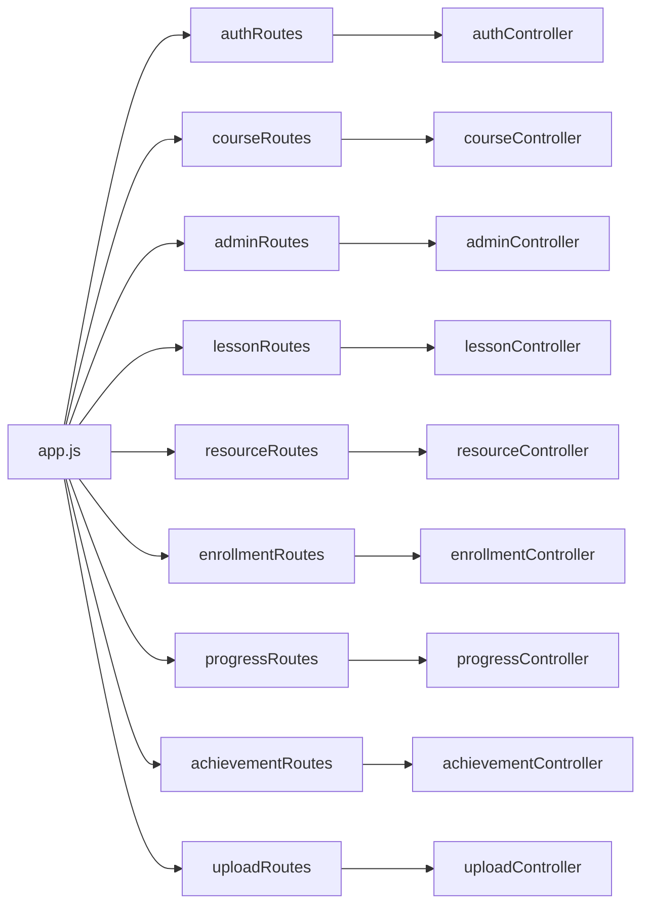
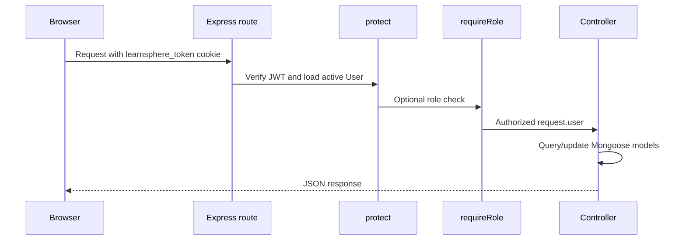

# Backend Architecture

## Startup and middleware

`server/src/server.js` calls `loadEnvironment()`, connects with `mongoose.connect(config.mongoUri)`, and starts the app on `config.port`. A connection/startup error is logged and sets a failing process exit code.

`server/src/app.js` registers middleware in this order:

1. CORS with `origin: config.clientUrl` and credentials.
2. JSON parsing with a 2 MB limit.
3. Cookie parsing.
4. `/api/health`.
5. Route modules under their `/api/*` prefixes.
6. JSON 404 response.
7. Central error handler.

The error handler exposes generic internal errors, but returns validation, duplicate-key, cast, and upload-specific status/message structures.

## Route-to-controller map

## Controllers and models

- `authController`: `register` validates matching fields, checks email, hashes with bcrypt, creates a user, and sets a JWT cookie. `login` selects the hidden password and compares it. `getMe` returns the authenticated public projection; `logout` clears the cookie.
- `courseController`: `listCourses` applies publication visibility, text/category/difficulty filters, pagination, and `createdBy` population. `getCourse` returns a course and ordered lessons. `createCourse` slugifies the title and records `createdBy`. `updateCourse` re-slugifies changed titles and validates objectives. `deleteCourse` removes the course and its lessons.
- `lessonController`: lists ordered lessons, verifies course existence before creation, and performs validated update/delete.
- `resourceController`: lists resources for an accessible course, validates URL/course existence on creation, and deletes metadata.
- `enrollmentController`: checks published-course enrollment, creates Enrollment and Progress, awards first enrollment, and assembles dashboard/learning responses.
- `progressController`: lists learner progress; validates lesson/course/enrollment before last-access or completion changes; calculates percentages and completion dates; updates both Progress and Enrollment; awards lesson/course achievements.
- `achievementController`: returns the current user’s achievements ordered by earned date.
- `adminController`: supplies public stats, dashboard analytics, learner search/pagination and aggregates, and one learner’s populated progress.
- `uploadController`: validates that Multer supplied a file, checks Cloudinary configuration, streams the memory buffer to the `learnsphere` folder, and returns a secure URL/public ID/resource type.

## Authorization chain

`protect` rejects absent cookies, verifies with `JWT_SECRET`, loads the user without password, and rejects inactive users. `requireRole('admin')` returns `403` for non-admins. `requireCourseAccess` permits admins or requires an Enrollment for the requested course.

## Utilities

- `utils/auth.js`: token payload is `{ userId }`; cookie is HttpOnly, secure in production, and uses `sameSite=lax` in development or `none` in production.
- `utils/courseAccess.js`: enrollment gate for learning/resource reads.
- `utils/achievements.js`: uses unique `(user,type)` and upsert to avoid duplicate awards.
- `middleware/upload.js`: memory storage, six allowed MIME types, 100 MB limit.

## Backend concerns found in code

- `GET /lessons/course/:courseId` is public and does not filter unpublished courses or require enrollment.
- Course update spreads the entire request body into the update object; a future caller could attempt to change fields beyond the intended editable set.
- Course deletion does not clean resources, enrollments, or progress.
- Resource creation checks the course but does not verify that an optional `lesson` belongs to that course.
- The API has no request-rate limiting, CSRF token mechanism, or audit logging visible in the repository. The HttpOnly cookie and credentialed CORS reduce token exposure but do not by themselves provide CSRF protection.
