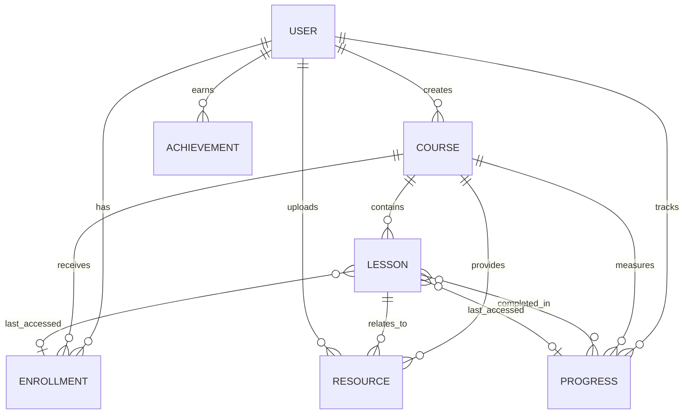

# Database Schema

MongoDB is accessed through Mongoose. Every schema uses `{ timestamps: true }`, which adds `createdAt` and `updatedAt`.

## Models

### User (`users`)

| Field | Type and rules |
|---|---|
| `name` | String, required, trimmed, 2–80 characters |
| `email` | String, required, lowercase/trimmed, email regex, unique |
| `password` | String, required, minimum 8 characters, `select: false`; stored as bcrypt hash |
| `role` | `user` or `admin`, default `user` |
| `avatar` | String, default empty |
| `isActive` | Boolean, default `true` |

### Course (`courses`)

`title` is required, trimmed, 3–140 characters; `slug` is required, lowercase/trimmed, unique; `description` is required and max 5,000 characters; `thumbnail` defaults empty; `category` is required/max 60; `difficulty` is `beginner`, `intermediate`, or `advanced` and defaults to `beginner`; `instructor` is required/max 120; `objectives` is an array of strings defaulting to `[]`; `isPublished` defaults false; `createdBy` references `User` and is required. A text index covers title, description, and category.

### Lesson (`lessons`)

`course` references `Course` and is indexed; `title` is required/max 160; `description` defaults empty/max 5,000; `videoUrl` defaults empty; `duration` is a number with minimum 0/default 0; `order` is a required number with minimum 1; `module` defaults `General`/max 100; `isPreview` defaults false. `(course, order)` is unique.

### Resource (`resources`)

`title` is required/max 160; `description` defaults empty/max 1,000; `fileUrl` is required; `fileType` defaults `application/pdf`; `course` references `Course` and is indexed; `lesson` optionally references `Lesson`; `uploadedBy` references `User` and is required.

### Enrollment (`enrollments`)

`user` references `User`, `course` references `Course`, both required; `enrolledAt` defaults to now; `lastAccessedLesson` optionally references `Lesson`. `(user, course)` is unique.

### Progress (`progresses`)

`user` and `course` are required references; `completedLessons` is an array of `Lesson` references; `lastAccessedLesson` optionally references `Lesson`; `completionPercentage` is 0–100/default 0; `completedAt` defaults null. `(user, course)` is unique.

### Achievement (`achievements`)

`user` references `User`; `title` and `description` are required strings; `type` is one of `first-enrollment`, `first-lesson`, `course-completed`, or `learning-enthusiast`; `earnedAt` defaults to now. `(user, type)` is unique, making awards idempotent.

## Relationships

## Data operations

- Registration creates a `User` after bcrypt hashing.
- Course creation creates a `Course` owned by the authenticated admin.
- Enrollment creates one `Enrollment` and an initial `Progress` document.
- Completion adds a lesson with `$addToSet`, updates the last accessed lesson, calculates `round(completed / total * 100)`, and sets `completedAt` at 100%.
- Achievements are generated after enrollment or lesson completion with `updateOne(..., { upsert: true })`.
- Resources are metadata records; their actual uploaded bytes go to Cloudinary and the returned URL is stored in `Resource.fileUrl`.

No schema-level cascade exists. Deleting a course explicitly deletes lessons only, so related resources, enrollments, and progress require separate cleanup.
