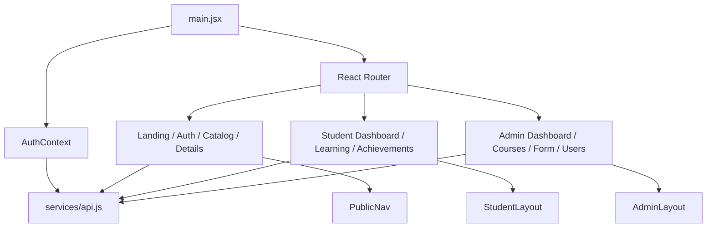

# Frontend Architecture

## Entry point and routing

`client/src/main.jsx` renders `StrictMode > BrowserRouter > AuthProvider > Routes` and mounts `Toaster`. Routes are:

| Path | Page | Access |
|---|---|---|
| `/` | `LandingPage` | Public |
| `/login`, `/register` | `AuthPage` | Public; redirects authenticated users |
| `/courses` | `CourseCatalog` | Public |
| `/courses/:id` | `CourseDetails` | Public, optional session |
| `/dashboard` | `StudentDashboard` | `StudentRoute` |
| `/achievements` | `Achievements` | `StudentRoute` |
| `/courses/:courseId/learn` | `CourseLearning` | `StudentRoute` |
| `/admin/dashboard` | `AdminDashboard` | `AdminRoute` |
| `/admin/courses` | `AdminCourses` | `AdminRoute` |
| `/admin/courses/new`, `/admin/courses/:id/edit` | `AdminCourseForm` | `AdminRoute` |
| `/admin/users` | `AdminUsers` | `AdminRoute` |

`AdminRoute` and `StudentRoute` read `useAuth()`, show loading, check the exact role, and redirect to `/login`. `ProtectedRoute.jsx` is a separate generic wrapper that preserves the requested pathname in navigation state but is currently not referenced.

## State and API

`AuthProvider` owns `user` and `loading`. On mount it calls `/auth/me`, which rehydrates the session from the HttpOnly cookie. `login`, `register`, and `logout` call the API and update context. Pages use local `useState` and `useEffect`; there is no Redux or query cache.

`api.js` uses `VITE_API_URL || http://localhost:5000/api` and `withCredentials: true`. Pages call this instance directly and handle failures with `react-hot-toast`.

## Page and component responsibilities

- `LandingPage`: public marketing page and `/courses/stats` live counters; composes `PublicNav` and `Logo`.
- `AuthPage`: login/register form, client-side confirmation check, redirects based on role/original location.
- `CourseCatalog`: `/courses` search/filter/pagination UI.
- `CourseDetails`: course/lesson preview, enrollment check, and enrollment action.
- `StudentDashboard`: enrolled course cards and derived completed-course, lesson, and average-progress stats.
- `CourseLearning`: loads learning data/resources, selects lessons, saves last access, renders video/resource links, and marks completion.
- `Achievements`: maps four possible achievement types to earned/locked cards.
- `AdminDashboard`: loads admin courses and analytics.
- `AdminCourses`: searchable course list and delete action.
- `AdminCourseForm`: create/edit form, newline-to-objective conversion, thumbnail upload, publish flag.
- `AdminUsers`: searchable paginated users and aggregate progress.
- `PublicNav`: anchor links, login/register links, responsive mobile menu.
- `StudentLayout`/`AdminLayout`: sidebar navigation, user identity, logout action.
- `Logo`: reusable home link.

## Styling

`style.css` is a single global stylesheet with CSS custom properties, reusable button/link/form classes, separate visual sections for marketing, authentication, admin, student, catalogue, course details, and learning screens, plus `@media` rules at 800, 900, and 600 pixels. Marketing elements use `rise` animations unless reduced motion is requested. The layouts collapse to single columns and a mobile navigation menu at smaller widths.

## Verified frontend gaps

- There are no client pages for creating/editing lessons or resources even though the API supports them.
- `recharts` is installed but no chart component is imported.
- Admin “Settings” and learner “My profile” are anchor placeholders marked “soon”.
- `AdminUsers` does not link to `/admin/users/:userId`, so the detailed progress endpoint has no current UI caller.
