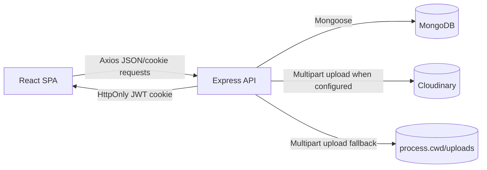

# LearnSphere LMS: Project Overview

## Purpose

LearnSphere is a MERN learning-management system. It lets visitors browse published courses, create learner accounts, enroll in courses, watch lessons, download course resources, track lesson/course completion, and earn achievements. Administrators can create and publish courses, manage course records, upload assets through Cloudinary or local disk fallback, view platform analytics, and inspect learner summaries.

The implementation is split into:

- `client/`: a Vite-powered React single-page application.
- `server/`: an Express API backed by MongoDB through Mongoose.
- MongoDB: stores users, courses, lessons, resources, enrollments, progress, and achievements.
- Upload storage: optional Cloudinary external storage, with a local `<process.cwd>\uploads` fallback when Cloudinary credentials are absent.

## Architecture

`client/src/services/api.js` creates one Axios client with `withCredentials: true`. Its base URL is `VITE_API_URL`, defaulting to `http://localhost:5000/api`. The server enables CORS for `CLIENT_URL`, parses JSON and cookies, registers route modules, and connects to MongoDB in `server/src/server.js`.

## Main user experiences

1. A visitor opens `/`, sees live public counts, and navigates to `/courses`.
2. The catalogue calls `GET /api/courses` and supports text search, category, difficulty, and pagination.
3. Course details call `GET /api/courses/:id`. A logged-in learner can enroll with `POST /api/enrollments`.
4. The learner dashboard calls `GET /api/enrollments/my-courses`; learning pages call the protected learning and resource endpoints.
5. Completing a lesson updates `Progress`, mirrors the last accessed lesson on `Enrollment`, recalculates the percentage, and may create an `Achievement`.
6. Administrators authenticate using the same login page, then use `/admin/*` pages and admin-only API routes.

## Technology stack

| Area | Technologies actually used |
|---|---|
| Frontend | React 19, React DOM, React Router DOM 7, Vite 8, Axios |
| Frontend UI | lucide-react icons, react-hot-toast notifications, one `style.css` |
| Charts | `recharts` is installed but not imported by the current source |
| Backend | Node.js ES modules, Express 5, cookie-parser, CORS |
| Persistence | MongoDB with Mongoose 8 |
| Security | bcryptjs password hashing, jsonwebtoken, HttpOnly cookie JWT |
| Uploads | Multer memory validation, optional Cloudinary, or local `<process.cwd>\uploads` |
| Development | concurrently, nodemon |

## Operational boundaries

The application has no server-rendered frontend, test suite, or separate frontend API service layer beyond the single Axios instance. Route handlers and controllers are the API contract. `server/src/config/env.js` provides defaults for the port, MongoDB URI, JWT expiry, and environment, but `JWT_SECRET` and `CLIENT_URL` are required at startup.

## Important verified limitations

- The admin UI manages course records but has no visible lesson/resource management screens; those APIs exist.
- The admin user list displays aggregate progress, but the available per-user progress endpoint is not wired to a detail page.
- `ProtectedRoute.jsx` exists but is not used by the current router; `main.jsx` defines separate `AdminRoute` and `StudentRoute`.
- Course deletion removes lessons only. It does not explicitly remove related resources, enrollments, or progress documents.
- Cloudinary is optional; when its three credentials are absent, the upload endpoint writes a UUID-named file to `<process.cwd>\uploads` and serves it from `/uploads/<filename>`.
