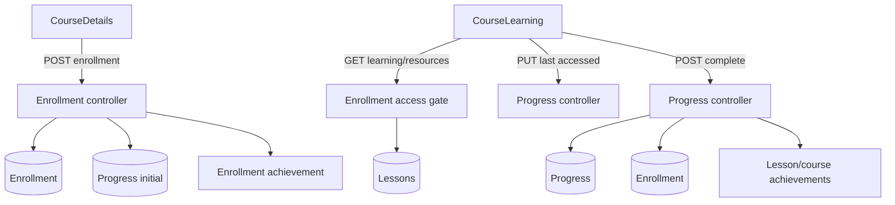

# Workflow Documentation

## Registration

`AuthPage` submits the registration form to `AuthContext.register`, which calls `POST /auth/register`. `register` validates strings, password confirmation and length, normalizes email, checks `User`, hashes with bcrypt cost 12, creates a learner, signs a JWT, and sets `learnsphere_token`. The response user is stored in context and the browser navigates to `/dashboard`.

## Login, persistence, and logout

Login uses `AuthPage -> AuthContext.login -> POST /auth/login -> login`. The controller retrieves the password with `select('+password')`, compares bcrypt, rejects inactive users, then sets the cookie. On refresh, `AuthProvider` calls `GET /auth/me`; `protect` verifies the cookie and reloads the active user. Logout from either layout calls `POST /auth/logout`, clears the cookie, clears context, and navigates to `/login`.

## Admin access

The admin seed script upserts a configured admin with a bcrypt password and `role: 'admin'`. After login, `AuthPage` routes the account to `/admin/dashboard`. `AdminRoute` checks the role in the client, while every admin API route independently executes `protect` followed by `requireRole('admin')`. Dashboard requests call `/admin/courses` and `/admin/analytics`; the server counts users/courses/lessons/enrollments/completions and aggregates top courses.

## Course creation and upload

`AdminCourseForm` sends `POST /uploads` as multipart `file` for a thumbnail. The route executes `protect -> requireRole -> upload.single('file') -> uploadAsset`; Multer validates the MIME type and 100 MB limit in memory, then `uploadAsset` sends the buffer to Cloudinary's `learnsphere` folder when configured or writes a UUID-named file to the server's `uploads` directory otherwise. The returned URL is sent in `POST /courses` or `PUT /courses/:id` with the course fields and newline-derived objectives. `createCourse` slugifies the title and stores the admin ID in `Course.createdBy`.

Lesson and resource APIs exist for admin authoring. No current client page calls the lesson/resource create endpoints, so those operations require an external API client or future UI.

## Enrollment and learning

`CourseDetails` loads `GET /courses/:id` and, for an authenticated user, `GET /enrollments/course/:id`. Clicking enroll sends `POST /enrollments`. The server requires a published course, prevents duplicate `(user,course)`, creates `Enrollment` and `Progress`, and awards `first-enrollment`. The page navigates to `/courses/:id/learn`.

`CourseLearning` calls both `GET /enrollments/course/:courseId/learning` and `GET /resources/course/:courseId`. Both are protected; course learning/resources require enrollment (or admin). The screen selects the saved last lesson or first lesson, renders `videoUrl` if present, and displays resource links.

## Lesson completion and progress

Selecting a lesson calls `PUT /progress/:courseId/last-accessed/:lessonId`, which verifies the lesson belongs to the course and the learner is enrolled, then updates both `Enrollment.lastAccessedLesson` and `Progress.lastAccessedLesson`.

The complete button calls `POST /progress/:courseId/complete-lesson/:lessonId`. The controller verifies lesson/course and enrollment, upserts Progress, `$addToSet`s the lesson, counts all course lessons, computes `Math.round(completed / total * 100)`, sets `completedAt` at 100%, updates Enrollment, and returns progress. The client replaces its progress state and shows a toast.

## Achievement generation

Enrollment count exactly one awards `first-enrollment`. The first aggregate-completed lesson awards `first-lesson`. A 100% course awards `course-completed`; at least three completed courses awards `learning-enthusiast`. `Achievement.updateOne` with the unique `(user,type)` index makes repeated triggers safe.

## Administration of learners

`AdminUsers` calls `GET /admin/users` with search/page/limit. `listUsers` excludes passwords, counts enrollments, calculates completed-course count and average percentage, and returns pagination. `GET /admin/users/:userId` exists and returns populated progress, but no current frontend screen links to it.

